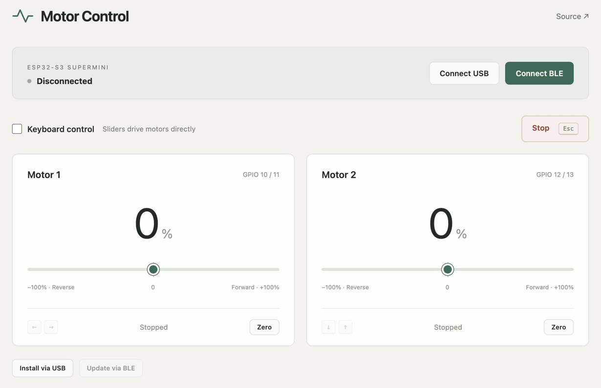

[Open Motor Control](https://qwertpas.github.io/vibration/)

Control two bidirectional motors over USB or BLE with an ESP32-S3 SuperMini.

Open in your browser and choose **Connect USB** or **Connect BLE** → **Vibration**. Sliders run from −100% to +100%.

Enable **Keyboard control** to set speeds without moving the motors. Hold ←/→ for motor 1 and ↓/↑ for motor 2; slider magnitudes set speed. Release to stop. **Esc** stops both.

**Install via USB** installs the firmware. While connected over BLE, **Update via BLE** flashes the published firmware wirelessly. Motors stay stopped during updates.

| Motor | Bridge inputs |
| --- | --- |
| 1 | GPIO 10, 11 |
| 2 | GPIO 12, 13 |

Connect ESP32 and bridge grounds together. Power motors through the bridges. Outputs stop on disconnect or after 500 ms without control commands.
